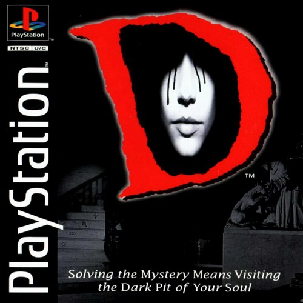
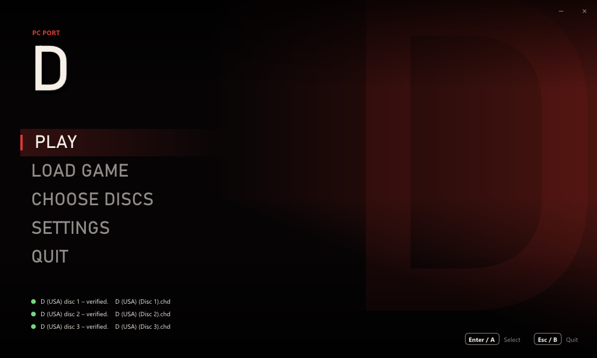
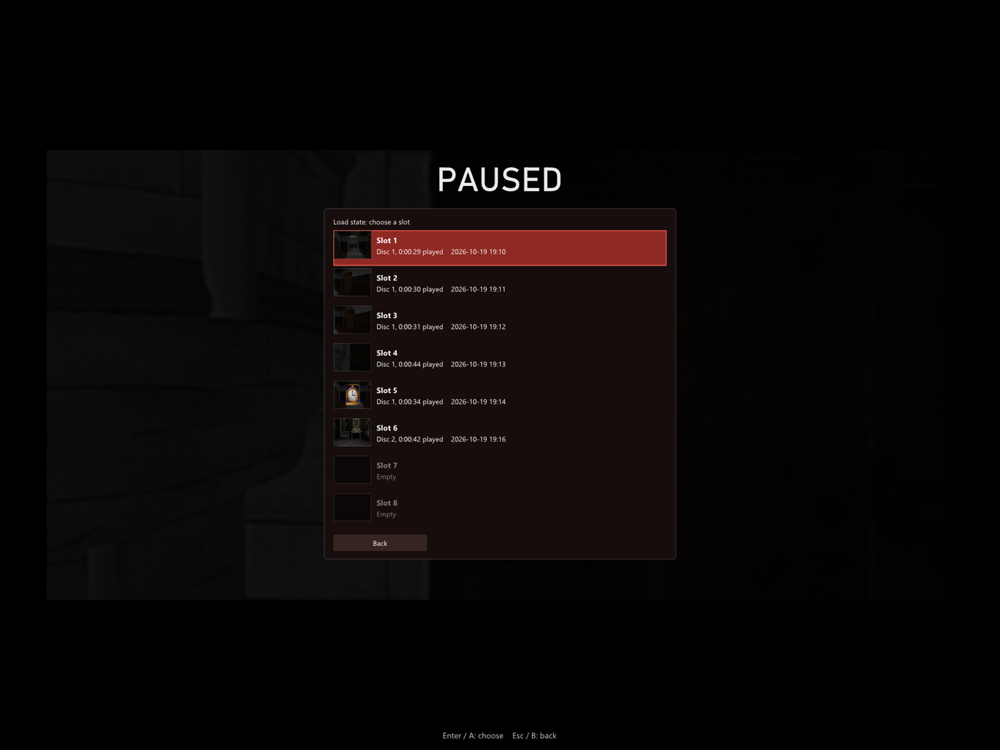
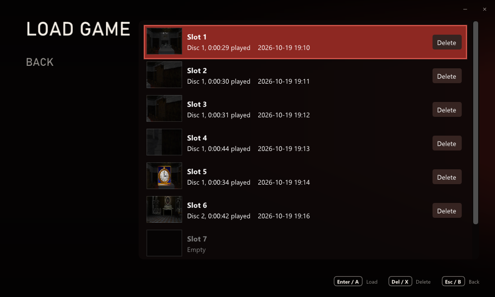
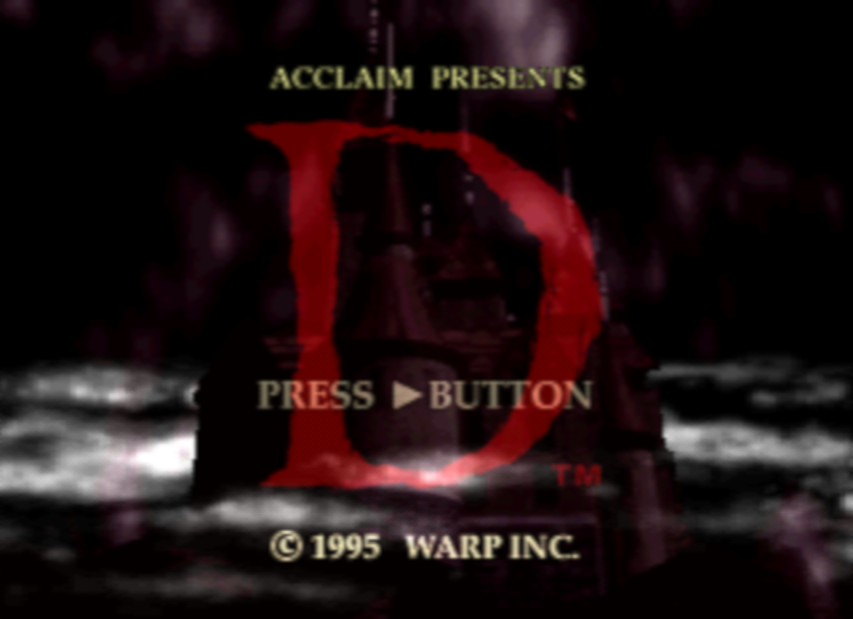
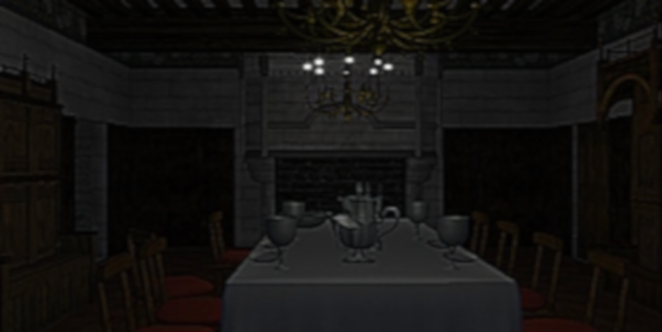
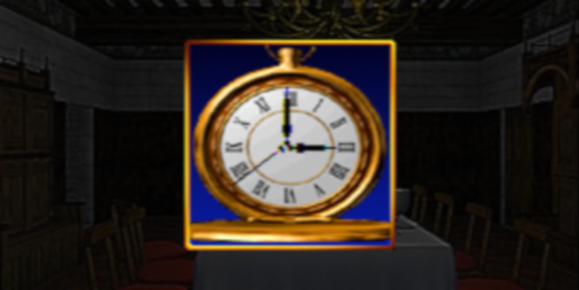
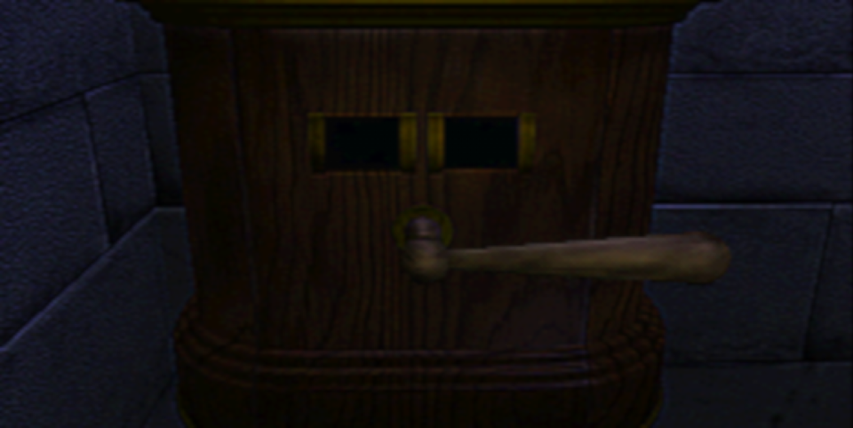
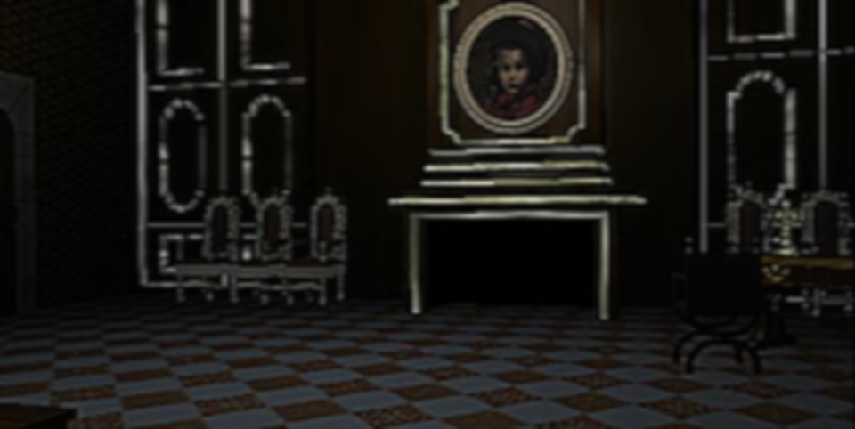
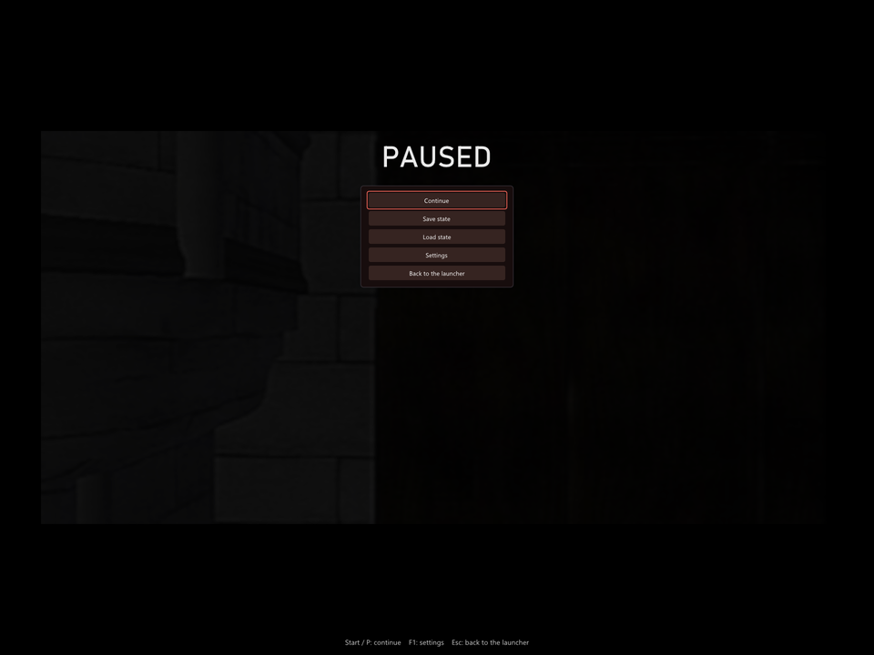

# D – PC port

A native Windows version of the PlayStation horror adventure **D**
(WARP / Acclaim, 1995). It runs the game's own logic natively on Windows –
no emulator and no BIOS – with **save states**, **pause anywhere**, sharper
pictures and a number of quality-of-life improvements.

**You need your own copy of the game.** The port reads the movies, pictures,
sound and data from disc images that you make from your own three original
discs.

  
   
  <em>The game this port needs: D (USA), SLUS-00128 / 00173 / 00174. Cover © its respective owners.</em>

## Save anywhere – a first for D

The original D has no way to save. It wants to be finished in one sitting:
two hours of real time in Laura's nightmare, and if you have to stop, you
start over. This port changes that.

- **Pause at any moment** – with Start or P, even in the middle of a movie.
  The picture freezes, and the movie and its sound go on exactly where they
  stopped.
- **Save states in 8 slots**, each with a picture of the moment, the disc,
  the time played and the date. Save while you explore the castle, in a
  movie or in the inventory, and pick up exactly where you left off – same
  room, same clock, same movie frame.
- **Load from the pause menu**, or start the game straight from a save with
  **LOAD GAME** in the launcher. The right disc is put in by itself.
- **Delete** the saves you no longer need, from the same list.
- Saves are made to **survive updates** of the port: the game's code lives
  in its own `game.dll`, which stays the same between releases. If a save
  ever cannot be loaded, the list says why instead of failing.

*The pause menu's list of save states: one picture per slot, with the disc,
the time played and when it was saved.*

*LOAD GAME in the launcher: start from any save, or delete it.*

## Download

**[⬇ Download the latest release (d-pc.zip)](https://github.com/Bitsandbreakpoints/d-psx-pc-recomp/releases/latest/download/d-pc.zip)**

All releases are on the [Releases page](https://github.com/Bitsandbreakpoints/d-psx-pc-recomp/releases).

1. Download `d-pc.zip` and unzip it anywhere. Keep `d.exe` and `game.dll`
   together.
2. Start `d.exe` (Windows 10 or later; no installation).
3. Click **CHOOSE DISCS** and pick your three disc images at once
   (Ctrl/Shift-click), or drop them on the window. `.bin`/`.cue` and
   `.chd` work. If you choose only one, the others are found next to it.
   Each disc is checked against the known dump of *D (USA)* the first time.
4. Click **PLAY**. When the game asks for the next disc, it is put in by
   itself – no swapping.

## Pictures

*In-game pictures: D running in this port (4:3, soft-TV filter). The game's
pictures shown here are © their respective owners.*

## Disclaimer

- **You must own the game.** To play, you need dumps (disc images) of your
  own three original *D (USA)* discs. This project does not provide, and
  will not help you find, game files.
- **This repository contains no game files:** no code, movies, graphics,
  sound, music or data files from the game, and no BIOS. It holds only this
  README, the third-party licence list and pictures: the launcher and its
  lists (our own), plus the box cover and in-game pictures, which are © their
  respective owners and shown only to identify the game.
- **No game assets are distributed.** The release contains the port's own
  program and the licences of the open-source libraries it uses. Every
  movie, picture and sound is read at run time from your own disc images.
  The program is the game's logic rebuilt for Windows; it includes the small
  tables the code needs (texts, the layout of rooms and movies – about 3 KB
  that also appear on the disc) but none of the game's assets.
- *D* is a trademark of its owner. This is a non-commercial fan project and
  is not affiliated with or endorsed by WARP, Acclaim or Sony.

## Improvements over the original

All of these can be changed under **SETTINGS** (and most of them in the
game with **F1**).

**Saving and pausing**
- **Save states**: 8 slots with pictures, from the pause menu; **LOAD GAME**
  in the launcher; delete with a confirmation.
- **Pause anywhere**, movies included (Start, P, Pause or R3).

**Pictures and movies**
- **Movies decoded like the console**: the PlayStation's MDEC decoding
  rewritten to match it (the same integer IDCT), with an optional
  **smoother colour** mode that removes the blocky colour edges.
- **Higher internal resolution**, up to 4×: the turning views and the
  scaled pictures of the puzzles are drawn sharper.
- **Picture filters**: sharp pixels, bilinear, CRT, or a soft-TV filter
  (GTU-like).
- **Window or borderless full screen**, any window size, 4:3 or stretched,
  vsync.

**Sound**
- Master, **movies and music**, and **sound effects** volume.
- **Softer bass**: some effects (scrolling in the inventory) are a deep
  thump that can make speakers rattle; this takes the deepest bass out, as
  the TV speaker the game was made for did. Off: exactly the console's
  sound.
- **No hitches**: the disc is read ahead on its own thread, so the sound
  never stutters when a new movie starts.

**Comfort**
- **Launcher**: a resizable splash window that remembers its size; choose
  all three discs at once and have them verified, change every setting,
  with mouse, keyboard or controller.
- **Automatic disc change**: the next disc goes in by itself.
- **Skip the intro** logos, and **quit from the title screen** with B / Esc.
- **In-game settings** with F1 (or Select + Start).
- **Controls**: keyboard or XInput controllers (Xbox and compatible), every
  button remappable, automatic mapping.
- **Disc images**: `.bin`/`.cue` and `.chd` (compressed).

## Controls

Plug-and-play with modern controllers!

| PS1 | Keyboard | Controller |
|---|---|---|
| D-pad | Arrow keys | D-pad or left stick |
| Cross | X | A |
| Circle | C | B |
| Square | Z | X |
| Triangle | S | Y |
| L1 / R1 | Q / E | LB / RB |
| L2 / R2 | 1 / 3 | LT / RT |
| Start | Enter | Start |
| Select | Backspace | Back |

Everything can be changed under **SETTINGS → CONTROLS**.

In the game: **Start** (or **P**) pauses and opens the menu – continue,
save state, load state, settings, back to the launcher. **Esc** goes back
to the launcher, **F1** (or Select + Start) shows the settings. (In the
intro and on the title screen, Start keeps its own job in the game.)

## Files

Everything stays in the program's folder:

- `settings.ini` – the settings.
- `saves/slot1.state` … `slot8.state` – the save states (under 1.5 MB each).
- `d.log` – a log for troubleshooting.

## FAQ

**Do I need a BIOS?** No. Everything the BIOS and Sony's libraries do on a
PlayStation is written anew in the port.

**Which version of the game?** *D (USA)*, the three discs SLUS-00128,
SLUS-00173 and SLUS-00174. Other dumps of the same game may work; the
launcher tells you if your image is not the known one.

**Why not `.iso`?** The movies and their sound are stored in raw CD sectors
that an `.iso` cannot hold. Use `.bin`/`.cue` or `.chd`.

**Is the source code available?** No. The port is built from a
decompilation of the game, which is not published.

## Credits

- Built with [Dear ImGui](https://github.com/ocornut/imgui) and
  [libchdr](https://github.com/rtissera/libchdr) (with zstd, LZMA SDK,
  miniz and dr_flac). Their licences are in [THIRD_PARTY.md](THIRD_PARTY.md)
  and in the `licenses` folder of the release.
